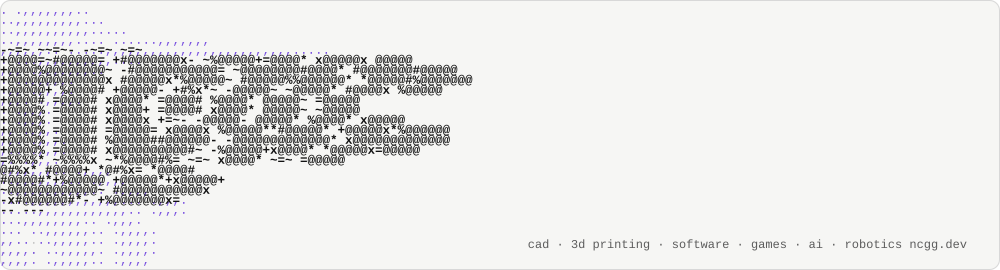

<a href="https://ncgg.dev">
  <picture>
    <source media="(prefers-color-scheme: dark)" srcset="assets/header-dark.svg">
    
  </picture>
</a>

  <a href="https://ncgg.dev"><b>ncgg.dev</b></a>&nbsp;&nbsp;·&nbsp;&nbsp;<a href="mailto:hello@ncgg.dev">hello@ncgg.dev</a>&nbsp;&nbsp;·&nbsp;&nbsp;discord <code>ncg_</code>

I make things you can hold, play and run: CAD and 3D printed parts, Android apps, games in Godot, local AI tools and competition robots. With FTC team 27308 I took the Finalist Alliance Award in the DECODE season. Currently learning Rust.

<table>
  <tr>
    <td width="50%">
      <picture>
        <source media="(prefers-color-scheme: dark)" srcset="assets/generated/stats-dark.svg">
        
      </picture>
    </td>
    <td width="50%">
      <picture>
        <source media="(prefers-color-scheme: dark)" srcset="assets/generated/langs-dark.svg">
        
      </picture>
    </td>
  </tr>
</table>

<picture>
  <source media="(prefers-color-scheme: dark)" srcset="assets/generated/heatmap-dark.svg">
  
</picture>

### building

| project | what it is | status |
|---|---|---|
| [**yume**](https://github.com/samncg/yume) | painting studio for Android tablets, made for the pen, canvases up to 16K | `v1.2.4` |
| [**ledger**](https://github.com/samncg/ledger-app) | local-first allowance budgeting, web + Android ([try it](https://samncg.github.io/ledger/)) | `live` |
| [**ncgg.dev**](https://github.com/samncg/ncgg.dev) | my portfolio: an ASCII fluid simulation in WebGL | `live` |
| **solace** | RP2350 handheld MP3/FLAC player, KiCad schematic done, board in layout | `in progress` |
| **ftc 27308** | DECODE robot: mecanum drive, intake, turret flywheel shooter | `finalist alliance` |

<picture>
  <source media="(prefers-color-scheme: dark)" srcset="assets/generated/toolbox-dark.svg">
  
</picture>

  

<picture>
  <source media="(prefers-color-scheme: dark)" srcset="https://raw.githubusercontent.com/samncg/samncg/output/snake-dark.svg">
  
</picture>

stats, languages and heatmap regenerate daily from public activity · <a href="scripts/build_cards.py">scripts/build_cards.py</a>
